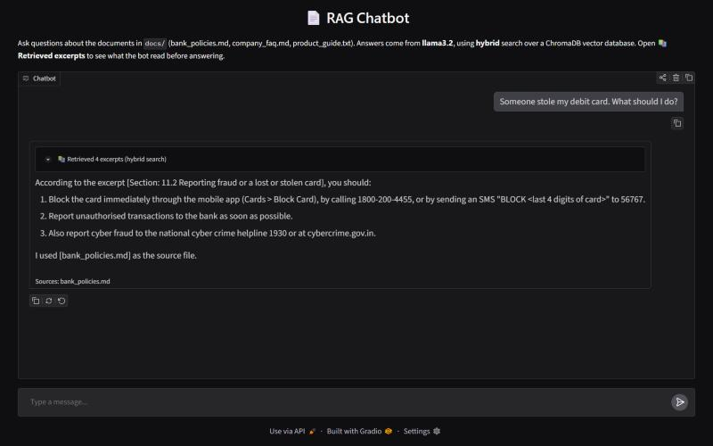
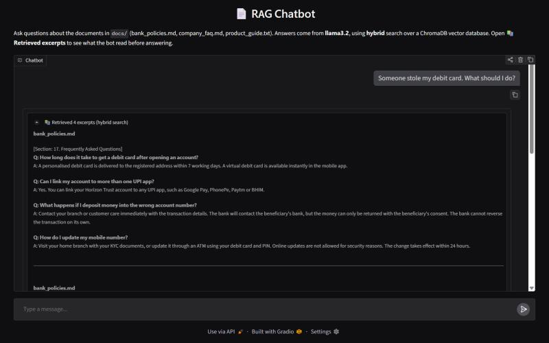

# RAG Chatbot

A simple chatbot that answers questions from your own documents using RAG
(retrieval-augmented generation). It runs fully on your own computer with free
models through [Ollama](https://ollama.com). No API key needed.

The sample knowledge base is a handbook for a fictional bank, so you can ask
things like *"Someone stole my debit card, what should I do?"* or *"What is the
FD rate for senior citizens?"*



Click **📚 Retrieved excerpts** to see exactly which parts of the documents the bot read before answering:



## How it works

```
docs/*.md, *.txt
      │  split into chunks by section
      ▼
 nomic-embed-text ──► ChromaDB vector database (vector_db/)
                                  │
 question ──► vector search + BM25 keyword search ──► merge (reciprocal rank fusion)
                                  │
                                  ▼
                  top 4 chunks + question ──► llama3.2 ──► answer with sources
```

1. Text files in `docs/` are split into chunks by section.
2. Each chunk is turned into a vector (an embedding) and saved in a ChromaDB vector database in `vector_db/`.
3. For each question, the most relevant chunks are found by meaning (vector search) and by keywords (BM25), and the two rankings are merged.
4. The chunks and the question are sent to the chat model, which answers from them.

**Tech stack:** Python · Ollama (llama3.2, nomic-embed-text) · ChromaDB · BM25 · Gradio

| File | What it is |
|---|---|
| `app.py` | Web chat page (Gradio) |
| `rag_chatbot.py` | The RAG pipeline: chunking, embeddings, vector DB, search, LLM calls. Also runs as a terminal chat. |
| `docs/` | The documents the bot answers from |

---

## Requirements

- **Python 3.10 or newer**: [python.org/downloads](https://www.python.org/downloads/)
- **Ollama**: [ollama.com/download](https://ollama.com/download)
- About **3 GB of free disk space** for the models, and **8 GB of RAM** or more

Works on Windows, macOS and Linux.

---

## Setup (one time per machine)

### 1. Get the project
Copy the project folder to the new machine, or clone it with git:
```bash
git clone <your-repo-url>
cd Chat_bot
```

### 2. Create a virtual environment and install packages

**Windows**
```bash
python -m venv .venv
.venv\Scripts\activate
pip install -r requirements.txt
```

**macOS / Linux**
```bash
python3 -m venv .venv
source .venv/bin/activate
pip install -r requirements.txt
```

### 3. Download the models
Make sure Ollama is installed and running, then:
```bash
ollama pull llama3.2
ollama pull nomic-embed-text
```

---

## Run

Activate the virtual environment if it isn't already (`.venv\Scripts\activate` on
Windows, `source .venv/bin/activate` on macOS/Linux).

**Web chat page:**
```bash
python app.py
```
Then open **http://localhost:7860** in your browser.

**Terminal chat:**
```bash
python rag_chatbot.py
```
Type `exit` to quit.

The first run embeds your documents, which takes a few seconds. Later runs load
them from `vector_db/`.

If something is missing (Ollama not running, a model not downloaded, packages
not installed), the bot stops and tells you the exact command to fix it.

---

## Share a live demo link

```bash
python app.py --share
```
Gradio prints a public link like `https://xxxx.gradio.live` that anyone can open
on their phone or laptop to chat with your bot.

- The bot still runs on **your** computer, so the link only works while your PC is on and `app.py` is running.
- The link expires after **72 hours**. Run the command again for a new one.
- Anyone with the link can use it, so share it only with people you want to.
- Some antivirus programs block the tunnel Gradio uses for the share link. If the link doesn't appear, check your antivirus.

---

## Using your own documents

Put `.txt` or `.md` files in `docs/`. Markdown headings (`#`, `##`, `###`) give
the best results, because chunks follow sections. The vector database rebuilds
itself automatically when the documents change.

---

## Settings

Every setting can be changed with an environment variable, so you don't need to
edit the code.

| Variable | Default | What it does |
|---|---|---|
| `OLLAMA_MODEL` | `llama3.2` | Chat model. `qwen2.5:7b` gives better answers but is slower. |
| `EMBED_MODEL` | `nomic-embed-text` | Embedding model |
| `RETRIEVAL` | `hybrid` | `vector`, `bm25`, or `hybrid` |
| `OLLAMA_HOST` | `http://localhost:11434` | Where Ollama runs. Change it to use Ollama on another machine. |
| `DOCS_DIR` | `./docs` | Folder with your documents |
| `DB_DIR` | `./vector_db` | Where the vector database is saved |
| `PROVIDER` | `ollama` | Set to `claude` to use the Claude API instead |
| `CLAUDE_MODEL` | `claude-opus-5-5` | Claude model when `PROVIDER=claude` |
| `ANTHROPIC_API_KEY` | none | Your key from console.anthropic.com, needed only for Claude |

Example on **Windows**:
```bash
set OLLAMA_MODEL=qwen2.5:7b
python rag_chatbot.py
```
Example on **macOS / Linux**:
```bash
OLLAMA_MODEL=qwen2.5:7b python rag_chatbot.py
```
If you switch to a model you haven't downloaded, run `ollama pull <model>` first.

---

## Troubleshooting

| Problem | Fix |
|---|---|
| `Can't reach Ollama` | Start the Ollama app (or run `ollama serve`). |
| `model ... isn't downloaded` | Run the `ollama pull` command it shows. |
| `ChromaDB isn't installed` | Activate the virtual environment, then `pip install -r requirements.txt`. |
| Answers are wrong or vague | Try a bigger model, e.g. `qwen2.5:7b`. |
| Strange search results after changing the embedding model | Delete the `vector_db/` folder. It rebuilds on the next run. |
